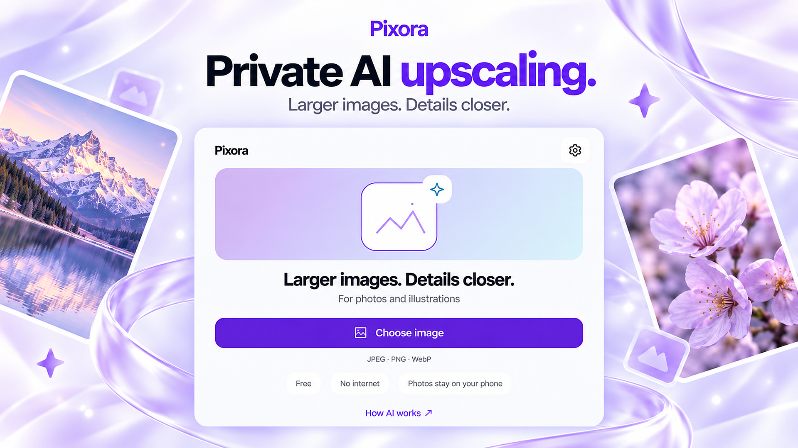
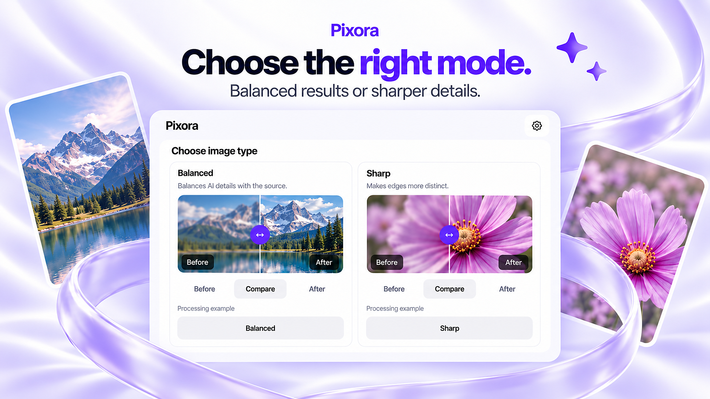
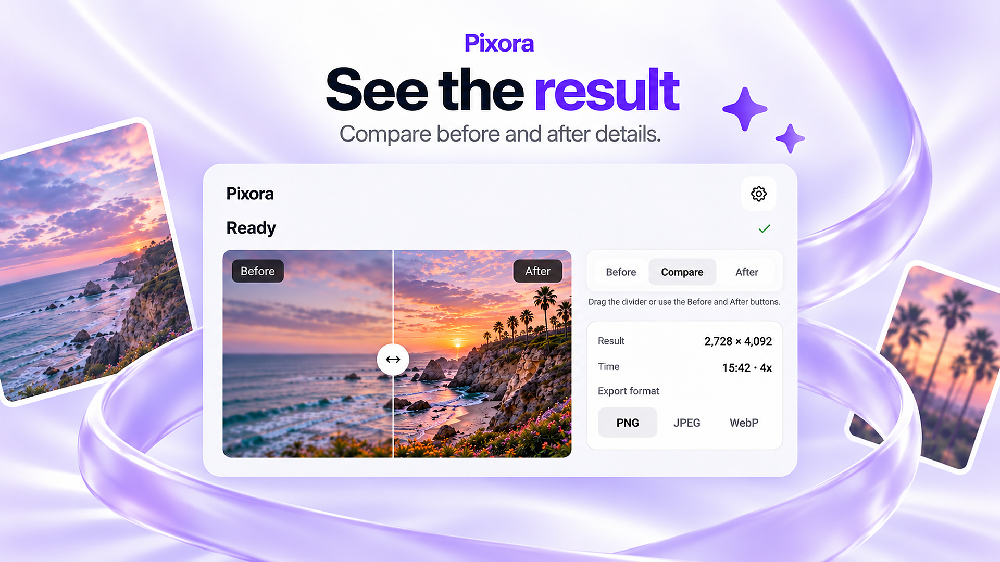
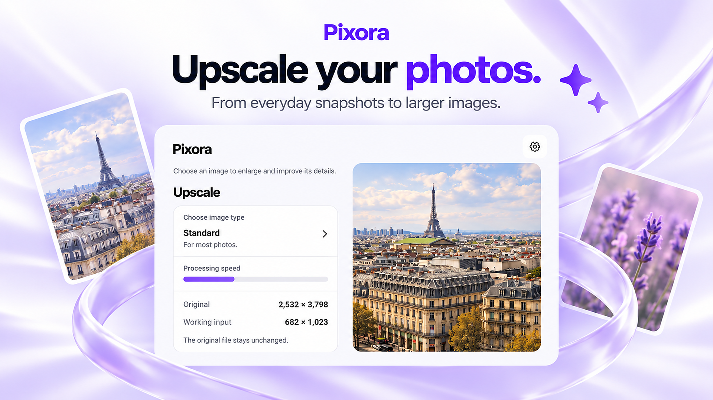

<p align="center">
  
</p>

<h1 align="center">Pixora</h1>

<p align="center">Enlarge a photo. Compare the details. Keep it on your device.</p>

<p align="center">
  <a href="https://github.com/kigya/pixora/actions/workflows/main.yml"></a>
  <a href="#platforms"></a>
  <a href="#platforms"></a>
</p>

<p align="center">
  <a href="#choose-a-look">Explore</a> ·
  <a href="#privacy">Privacy</a> ·
  <a href="#built-with">Tech stack</a> ·
  <a href="#build-from-source">Build from source</a>
</p>



Pixora makes **2× or 4×** copies of photos and illustrations. Enhancement models are bundled and work offline from the first launch. The experimental Recreate mode downloads a separate model package once, then also processes images locally. It is free, with no account, ads, subscriptions or credits.

<sub>The four images on this page are product illustrations. Sample comparisons, dimensions and times are illustrative. Online services are described under <a href="#privacy">Privacy</a>.</sub>

## Choose a look



Eight presets cover photos, illustrations and pixel art. Seven use bundled ncnn/Real-ESRGAN models; Pixel Art uses nearest-neighbor scaling to preserve pixel boundaries. A local suggestion can help you pick a mode. You decide whether to apply it.

## Recreate missing detail

Recreate uses the input image to guide local image-to-image generation. An optional description can guide the result. It can invent or change details; it does not recover a verifiable original.

The optional SD 1.5 Q4 + LCM package is **1.88 GB**. Download it explicitly, pause or resume the download, and remove it from Settings when you no longer need it. Cache cleanup keeps the model. The compact profile uses a 512×512 internal diffusion canvas, returns a crop with a long side of at most 256 pixels, then uses the existing AI upscaler. Model loading can be slow and memory use depends on the phone. Current device measurements are tracked in the verification report.

<p> </p>

<sub>The comparison shows a degraded input and an actual SD 1.5 Q4 + LCM img2img output. Generation can change markings and other details. This host example does not establish phone quality or speed. Source image: Mikhail Vasilyev, CC0; parameters and hashes are in <a href="assets/recreate/manifest.json">the asset manifest</a>.</sub>

## Compare before you save



Move the divider or switch between Before and After, then save or share a new copy as **PNG, JPEG or WebP**. PNG and lossless WebP preserve transparency. Your original stays unchanged.

AI can alter fine details; it cannot guarantee recovery of information missing from the original. The illustrated comparisons above are not verified outputs of the bundled models.

## See the size before you start



The preparation screen shows the original size and one expected result size. Enlargement applies to the prepared image; working and AI intermediate dimensions stay out of the interface. While it runs, follow progress and elapsed time, or cancel the job.

## Privacy

Photos are processed on your device and are never uploaded for inference. Images, filenames, URIs and support-message content are excluded from telemetry.

The optional model download requests fixed, hash-pinned files from Hugging Face and its delivery hosts. Those hosts receive ordinary connection information such as IP address. The app never includes your image, description, session, filename or URI in these requests.

Firebase usage analytics and error reporting have independent switches in Settings. Both currently default to enabled with an informational notice; saved opt-outs are preserved. Remote Config separately controls mode availability. After a newly saved internal result, an optional star dialog can appear at most once every five minutes. Ratings 1–4 open built-in support; 5 opens Google Play. A numeric rating and allowlisted technical generation parameters can enter Analytics when enabled. A written support message is sent only when you submit it, together with its rating, app version and a random request ID.

[Privacy policy](privacy/index.html) · [Data flow and telemetry](docs/observability/privacy.md)

## Built with

<p>
  <a href="https://reactnative.dev/"></a>
  <a href="https://react.dev/"></a>
  <a href="https://www.typescriptlang.org/"></a>
  <br>
  <a href="https://kotlinlang.org/"></a>
  <a href="ios/Native"></a>
  <a href="native/engine"></a>
  <a href="https://github.com/Tencent/ncnn"></a>
</p>

- Expo SDK 58, Expo Router and TypeScript for the interface. Kinetik UI 1.4.2 source components use Reanimated, Gesture Handler and Skia. Builds remain local with checked-in native projects.
- Kotlin on Android, Objective-C++ on iOS and a shared C++ inference core.
- stable-diffusion.cpp runs the optional CPU reconstruction pipeline; model weights stay outside the APK.
- ncnn runs the bundled enhancement models. Android uses Vulkan where supported, with CPU fallback; iOS uses CPU inference.
- Firebase Analytics, Crashlytics and Remote Config support the separate online features described above.

## Platforms

Android targets ARM64 phones and tablets running Android 10 or later. iOS targets 16.4 or later. Enhancement applies a 3.5 GiB memory check; Recreate has a stricter separate resource guard. These guards do not prove that a particular device can finish a job; processing time depends on the device, image and preset.

The interface supports light, dark and system themes, **34 active languages**, right-to-left layouts and scalable text. Translations have not been professionally reviewed.

Version 0.9.0 remains an experimental source revision. The current UX revision has real Xiaomi release-flow checks and automated tests; see the [current verification report](docs/engineering/ux-090.md) for exact scope and remaining gates. The strict whole-app coverage threshold is still 100% and has not passed for this revision. The compact Recreate profile replaces the fixed 6 GiB guard with dynamic resource checks; real-image generation and current verification limits are recorded in the report. No emulator or simulator was used. This repository does not offer a signed 0.9 store download.

## Build from source

Use **Node 22** and **JDK 21**. Android requires the pinned SDK/NDK; iOS requires macOS and the pinned Xcode toolchain.

```sh
git clone --recurse-submodules https://github.com/kigya/pixora.git
cd pixora
npm ci --legacy-peer-deps
```

Continue with the [Android and iOS build guide](docs/engineering/tooling.md) for native dependencies, local configuration and verification commands.

[Product requirements](docs/PRD.md) · [Feature registry](docs/product/features.md) · [Architecture](docs/ARCHITECTURE.md) · [Test matrix](docs/quality/test-matrix.md)

## Models and acknowledgements

Bundled models, optional model downloads and sample assets retain their original licenses and checksums. Reconstruction model use is subject to the included OpenRAIL restrictions. Kinetik and stable-diffusion.cpp include MIT notices. See the [third-party notices](docs/THIRD_PARTY_NOTICES.txt) for sources and license texts.
